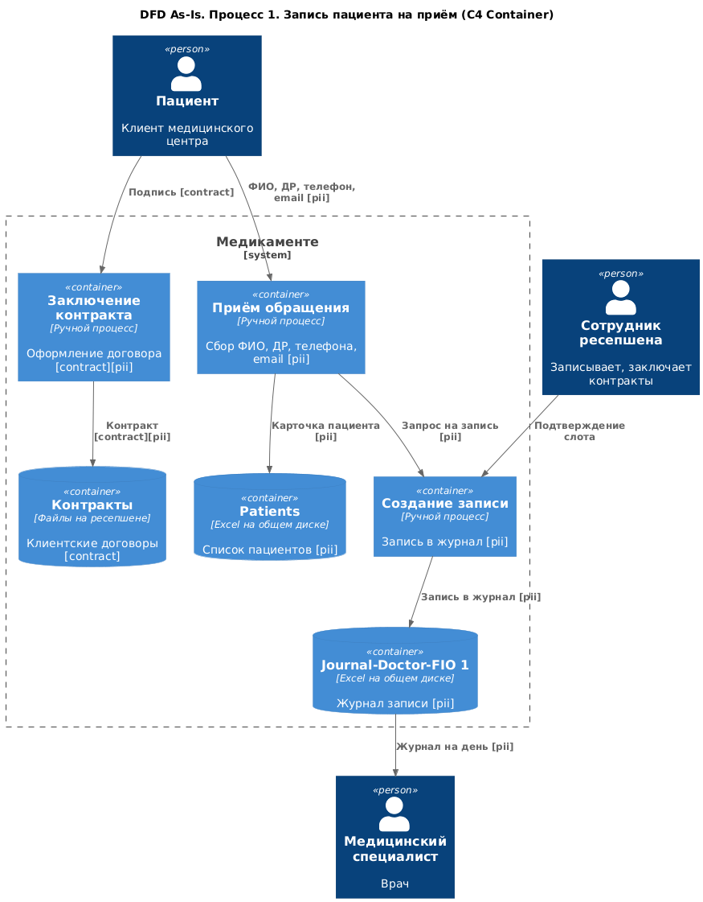
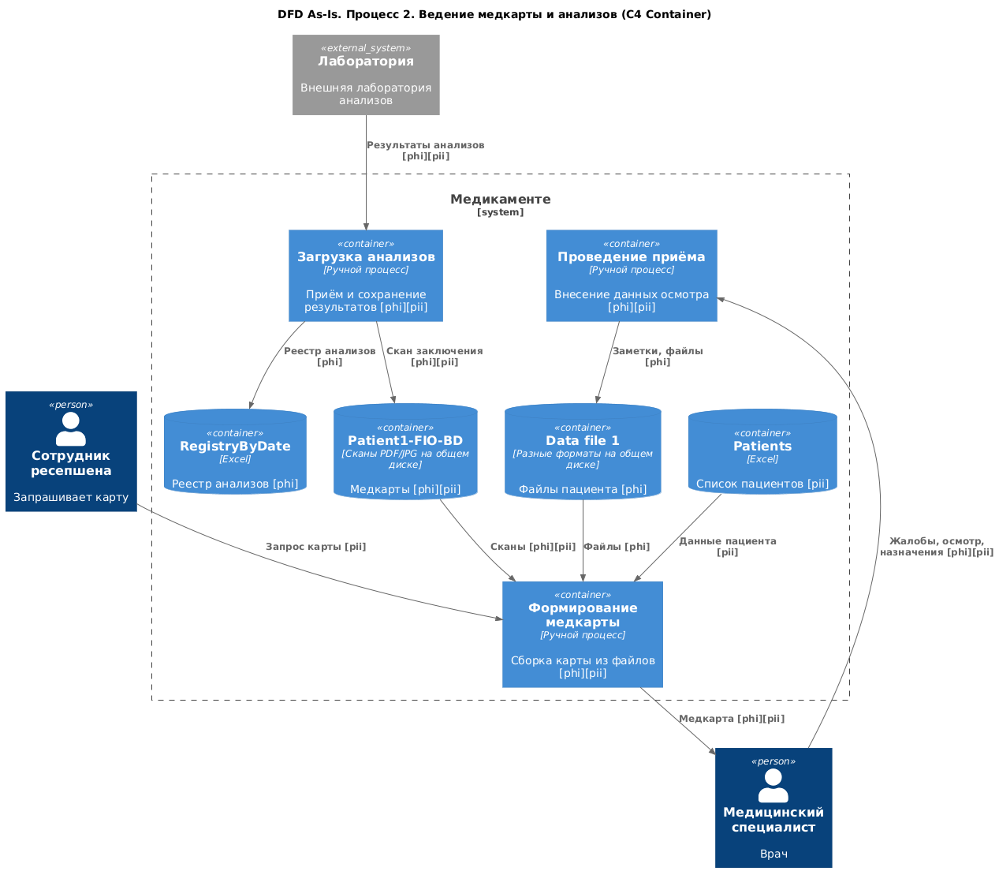
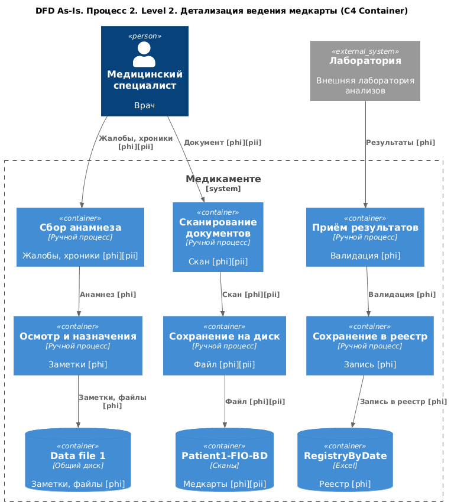
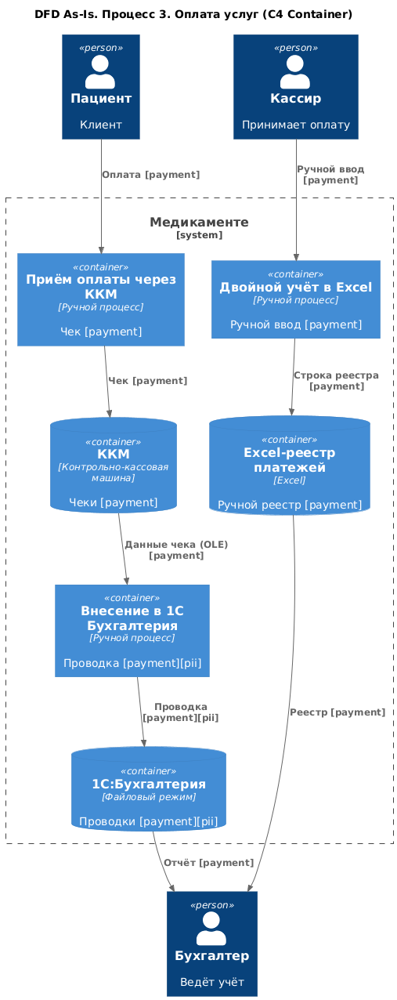
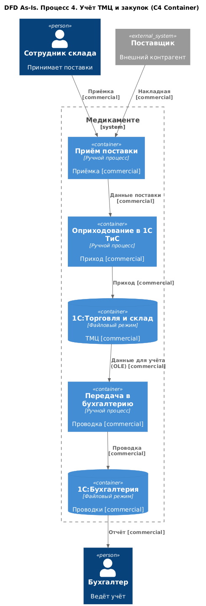
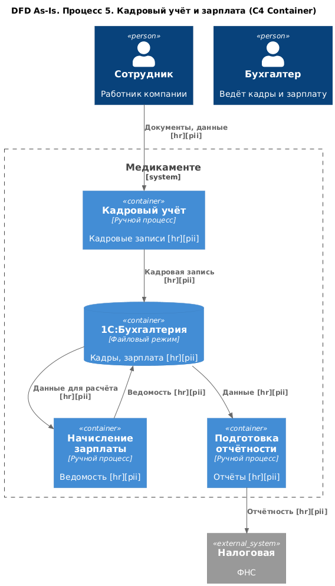
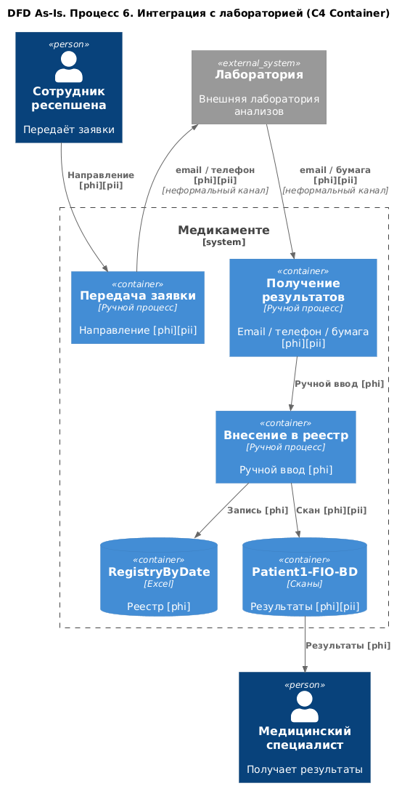

# DFD As-Is. Диаграммы потоков данных компании «Медикаменте»

## 1. Назначение и нотация

Документ содержит диаграммы потоков данных (DFD) состояния As-Is для ключевых бизнес-процессов «Медикаменте». 
Диаграммы построены на основе описания компании, текущей архитектуры (C4-контейнеры) 
и инвентаризации конфиденциальных данных (файл `01_Инвентаризация_конфиденциальных_данных.md`).

Цель — показать, как конфиденциальные данные перемещаются по системам компании, 
какие операции над ними выполняются и где находятся точки риска. Результат используется как вход для аудита мер безопасности (п.3) и проектирования мер защиты (п.4–5).

### 1.1. Нотация

Диаграммы построены в PlantUML. Канонические символы DFD Lucidchart заменены на ближайшие аналоги PlantUML 
— логика DFD при этом сохранена.

| Компонент DFD | Символ Lucidchart | Реализация в PlantUML |
|---|---|---|
| External entity | Прямоугольник | `actor` (человек) / `rectangle` (система) |
| Process | Круг / скруглённый прямоугольник | `usecase` (овал) |
| Data store | Открытый прямоугольник | `database` (цилиндр) |
| Data flow | Стрелка с подписью | Стрелка с текстом |

**Правила, которым подчиняются диаграммы:**
- У каждого процесса минимум один вход и один выход.
- У каждого хранилища минимум один входящий и один исходящий поток.
- Хранимые данные проходят через процесс.
- Control flow отсутствует: нет условий, циклов и порядка шагов — только движение данных.
- Конфиденциальные данные помечены тегами из инвентаризации:
- `[pii]`, `[phi]`, `[payment]`, `[contract]`, `[hr]`, `[commercial]`.
- Неформальные каналы (почта, телефон, бумага, мессенджеры) показаны пунктирной стрелкой `..>`.

### 1.2. Тип диаграмм

Все диаграммы — **physical DFD**: на них отражены реальные файлы, 
системы и серверы, а не абстрактные функции. Это соответствует состоянию As-Is.

### 1.3. Уровни

- **Level 1** — для всех шести процессов.
- **Level 2** — для процесса «Ведение медкарты и результатов анализов» 
- как наиболее чувствительного (PII + PHI + врачебная тайна).

## 2. Перечень процессов и диаграмм

| № | Процесс | Уровень | Файл диаграммы | Теги |
|---|---|---|---|---|
| 1 | Запись пациента на приём | Level 1 | `dfd_01_zapis.png` | `pii`, `contract` |
| 2 | Ведение медкарты и результатов анализов | Level 1 | `dfd_02_medkarta.png` | `pii`, `phi` |
| 2a | Ведение медкарты (детализация) | Level 2 | `dfd_02_medkarta_L2.png` | `pii`, `phi` |
| 3 | Оплата услуг | Level 1 | `dfd_03_oplata.png` | `payment`, `pii` |
| 4 | Учёт ТМЦ и закупок | Level 1 | `dfd_04_tmc.png` | `commercial` |
| 5 | Кадровый учёт и зарплата | Level 1 | `dfd_05_kadry.png` | `hr`, `pii` |
| 6 | Интеграция с лабораторией (текущее состояние) | Level 1 | `dfd_06_lab.png` | `pii`, `phi` |

Все диаграммы сохранены в папке `diagrams/` рядом с этим файлом. Исходный код — в приложении А.

## 3. Диаграммы с описанием

### 3.1. Запись пациента на приём

**Цель процесса.** Принять обращение пациента, собрать первичные данные, создать запись к специалисту и заключить клиентский контракт.

**Внешние сущности.** Пациент, сотрудник ресепшена, медицинский специалист.

**Процессы.**
- 1.1 Принять обращение и собрать данные.
- 1.2 Создать запись в журнале.
- 1.3 Заключить клиентский контракт.

**Хранилища данных.**
- `Journal-Doctor-FIO 1` — Excel-файл журнала записи, общий диск.
- `Patients` — Excel-файл со списком пациентов, общий диск.
- Контракты — файлы на ресепшене, место хранения не определено.

**Потоки данных.**
- Пациент → 1.1: ФИО, дата рождения, телефон, email `[pii]`.
- 1.1 → `Patients`: карточка пациента `[pii]`.
- 1.1 → 1.2: запрос на запись `[pii]`.
- 1.2 → `Journal-Doctor-FIO 1`: запись в журнал `[pii]`.
- `Journal-Doctor-FIO 1` → врач: журнал на день `[pii]`.
- 1.3 → Контракты: контракт `[contract][pii]`.

**Пометка конфиденциальности.** Все потоки, содержащие ФИО, контакты и данные контракта, несут теги `pii` и `contract`.

**Наблюдение.** Журнал и картотека ведутся в Excel на общем диске. Разграничения доступа на уровне файлов нет: любой, кто видит шару, читает все записи. Аудит обращений не ведётся.

---

### 3.2. Ведение медкарты и результатов анализов (Level 1)

**Цель процесса.** Зафиксировать результаты приёма, принять и сохранить результаты анализов, сформировать медицинскую карту пациента.

**Внешние сущности.** Медицинский специалист, лаборатория, сотрудник ресепшена.

**Процессы.**
- 2.1 Провести приём и внести данные.
- 2.2 Загрузить результаты анализов.
- 2.3 Сформировать медкарту.

**Хранилища данных.**
- `Patient1-FIO-BD` — сканы медкарт (PDF, JPG), общий диск.
- `Data file 1` — файлы пациента в разных форматах, общий диск.
- `RegistryByDate` — Excel-реестр анализов по дате.
- `Patients` — Excel-список пациентов.

**Потоки данных.**
- Врач → 2.1: жалобы, осмотр, назначения `[phi][pii]`.
- 2.1 → `Data file 1`: заметки и файлы `[phi]`.
- Лаборатория → 2.2: результаты анализов `[phi][pii]`.
- 2.2 → `RegistryByDate`: реестр анализов `[phi]`.
- 2.2 → `Patient1-FIO-BD`: скан заключения `[phi][pii]`.
- `Patient1-FIO-BD`, `Data file 1`, `Patients` → 2.3: сборка медкарты `[phi][pii]`.
- 2.3 → врач: медкарта `[phi][pii]`.

**Пометка конфиденциальности.** Процесс концентрирует одновременно PII и PHI. Каждый поток несёт минимум один из тегов `pii` или `phi`, большинство — оба.

**Наблюдение.** Сканы и файлы лежат на общем диске без разграничения доступа и аудита. Связи между `RegistryByDate`, `Patient1-FIO-BD` и `Patients` не формализованы — сопоставление идёт вручную по ФИО.

---

### 3.2a. Ведение медкарты (Level 2)

**Цель.** Детализировать процесс 2 до подпроцессов, чтобы увидеть точки сохранения файлов и отсутствие контроля.

**Подпроцессы.**
- 2.1.1 Сбор анамнеза.
- 2.1.2 Осмотр и назначения.
- 2.2.1 Приём результатов анализов.
- 2.2.2 Сохранение в реестр.
- 2.3.1 Сканирование документов.
- 2.3.2 Сохранение на общий диск.

**Хранилища.** `Data file 1`, `RegistryByDate`, `Patient1-FIO-BD` — те же, что на Level 1.

**Ключевой вывод.** На каждом шаге, где формируется файл, отсутствует тегирование и аудит записи. Доступ к конечным хранилищам имеет любой пользователь, видящий сетевую шару.

---

### 3.3. Оплата услуг

**Цель процесса.** Принять оплату, зафиксировать её в ККМ и в бухгалтерской системе, отразить в реестре.

**Внешние сущности.** Пациент, кассир, бухгалтер.

**Процессы.**
- 3.1 Принять оплату через ККМ.
- 3.2 Внести данные в «1С:Бухгалтерия».
- 3.3 Вести двойной учёт в Excel.

**Хранилища данных.**
- ККМ.
- «1С:Бухгалтерия предприятия» (файловый режим).
- Excel-реестр платежей.

**Потоки данных.**
- Пациент → 3.1: оплата `[payment]`.
- 3.1 → ККМ: чек `[payment]`.
- ККМ → 3.2: данные чека `[payment]` (OLE).
- 3.2 → 1С Бухгалтерия: проводка `[payment][pii]`.
- Кассир → 3.3: ручной ввод `[payment]`.
- 3.3 → Excel-реестр: строка реестра `[payment]`.
- 1С Бухгалтерия → бухгалтер: отчёт `[payment]`.
- Excel-реестр → бухгалтер: реестр `[payment]`.

**Наблюдение.** Двойной учёт: Excel и 1С расходятся, источник правды не определён. В 1С нет разграничения PII на уровне записей.

---

### 3.4. Учёт ТМЦ и закупок

**Цель процесса.** Принять поставку, оприходовать ТМЦ и передать данные в бухгалтерию.

**Внешние сущности.** Сотрудник склада, поставщик, бухгалтер.

**Процессы.**
- 4.1 Принять поставку.
- 4.2 Оприходовать в «1С:Торговля и склад».
- 4.3 Передать данные в бухгалтерию.

**Хранилища данных.**
- «1С:Торговля и склад» (файловый режим).
- «1С:Бухгалтерия предприятия» (файловый режим).

**Потоки данных.**
- Поставщик → 4.1: накладная `[commercial]`.
- Склад → 4.1: приёмка `[commercial]`.
- 4.1 → 4.2: данные поставки `[commercial]`.
- 4.2 → 1С ТиС: приход `[commercial]`.
- 1С ТиС → 4.3: данные для учёта `[commercial]` (OLE).
- 4.3 → 1С Бухгалтерия: проводка `[commercial]`.

**Наблюдение.** Данные не относятся к PII/PHI, но являются коммерческой тайной и требуют защиты. Файловый режим 1С ограничивает масштабируемость.

---

### 3.5. Кадровый учёт и зарплата

**Цель процесса.** Вести кадровый учёт, начислять зарплату и готовить отчётность.

**Внешние сущности.** Сотрудник, бухгалтер, налоговая.

**Процессы.**
- 5.1 Вести кадровый учёт.
- 5.2 Начислить зарплату.
- 5.3 Подготовить отчётность.

**Хранилища данных.** «1С:Бухгалтерия предприятия» (кадры, зарплата).

**Потоки данных.**
- Сотрудник → 5.1: документы и данные `[hr][pii]`.
- 5.1 → 1С Бухгалтерия: кадровая запись `[hr][pii]`.
- 1С Бухгалтерия → 5.2: данные для расчёта `[hr][pii]`.
- 5.2 → 1С Бухгалтерия: ведомость `[hr][pii]`.
- 1С Бухгалтерия → 5.3: данные `[hr][pii]`.
- 5.3 → налоговая: отчётность `[hr][pii]`.

**Наблюдение.** ПДн сотрудников не выделены как отдельный объект защиты, политика по ним не сформулирована.

---

### 3.6. Интеграция с лабораторией (текущее состояние)

**Цель процесса.** Передать заявку в лабораторию, получить результаты и внести их в реестр.

**Внешние сущности.** Лаборатория, сотрудник ресепшена, медицинский специалист.

**Процессы.**
- 6.1 Передать заявку в лабораторию.
- 6.2 Получить результаты вручную.
- 6.3 Внести результаты в реестр.

**Хранилища данных.**
- `RegistryByDate` (Excel).
- `Patient1-FIO-BD` (сканы).

**Потоки данных.**
- Ресепшен → 6.1: направление `[phi][pii]` (пунктир: email / телефон).
- Лаборатория → 6.2: результаты `[phi][pii]` (пунктир: email / бумага).
- 6.2 → 6.3: ручной ввод `[phi]`.
- 6.3 → `RegistryByDate`: запись `[phi]`.
- 6.3 → `Patient1-FIO-BD`: скан `[phi][pii]`.
- `Patient1-FIO-BD` → врач: результаты `[phi]`.

**Наблюдение.** API-интеграции нет. Обмен идёт вручную через почту, телефон и бумагу — это неформальный канал (отсылка к коллективным знаниям), который не контролируется и не аудируется.

## 4. Сводная карта конфиденциальных потоков

| Поток | Данные | Тег | Хранилище | Кто имеет доступ |
|---|---|---|---|---|
| Пациент → ресепшен | ФИО, ДР, телефон, email | `pii` | `Patients` (Excel) | Весь ресепшен, администраторы |
| Ресепшен → журнал | Запись к врачу | `pii` | `Journal-Doctor-FIO 1` | Весь ресепшен, врачи |
| Врач → файлы | Заметки, назначения | `phi` | `Data file 1` | Все, кто видит шару |
| Лаборатория → реестр | Результаты анализов | `phi` | `RegistryByDate` | Все, кто видит шару |
| Сканы → диск | Медкарты | `phi`, `pii` | `Patient1-FIO-BD` | Все, кто видит шару |
| Пациент → касса | Оплата | `payment` | ККМ, 1С Бухгалтерия | Кассир, бухгалтер |
| Касса → Excel | Платёж | `payment` | Excel-реестр | Кассир, бухгалтер |
| Сотрудник → 1С | Кадровые данные | `hr`, `pii` | 1С Бухгалтерия | Бухгалтер |
| Поставщик → склад | Накладные | `commercial` | 1С ТиС | Склад, бухгалтер |
| Лаборатория ↔ ресепшен | Направления, результаты | `phi`, `pii` | Вне систем (email, бумага) | Не контролируется |

## 5. Слепые зоны, выявленные на диаграммах

1. **Общий диск без разграничения доступа.** `Patient1-FIO-BD`, `Data file 1`, `Patients`, `Journal-Doctor-FIO 1` доступны всем, кто видит сетевую шару. На уровне файлов ограничений нет.
2. **Отсутствие аудита.** Ни один процесс не фиксирует, кто и когда читал или изменял конфиденциальные данные.
3. **Двойной учёт платежей.** Excel и 1С расходятся, источник правды не определён — риск ошибок и потери данных.
4. **Ручной обмен с лабораторией.** Направления и результаты идут через почту, телефон и бумагу — неформальный канал без контроля.
5. **Согласия на обработку ПДн.** На диаграммах не отражены, потому что процесса сбора и хранения согласий нет.
6. **ПДн сотрудников.** Кадровый учёт есть, но защиты и политики по ПДн сотрудников нет.
7. **Почта как канал ПДн.** Exchange не рассматривается как хранилище конфиденциальных данных, аудит почтовых потоков не ведётся.

## 6. Выводы

- Наиболее рискованные процессы — ведение медкарты (PII + PHI + врачебная тайна) и запись на приём (первичный сбор PII). Здесь концентрация конфиденциальных данных максимальна, а контроля меньше всего.
- Конфиденциальные данные выходят за периметр корпоративных систем в трёх местах: обмен с лабораторией, почта, неформальные каналы. Эти потоки не видны системам учёта.
- Двойной учёт платежей и отсутствие единого источника правды создают риск расхождений и затрудняют аудит.
- Ни один процесс не имеет механизма тегирования и аудита обращений к конфиденциальным данным. Это блокер для перехода к финальному состоянию из целей бизнеса.
- Результаты DFD — вход для аудита мер безопасности (п.3): каждый поток из раздела 4 будет сопоставлен с требованиями 152-ФЗ, 323-ФЗ и практиками Privacy by Design / Data Minimization / Data Lineage.
