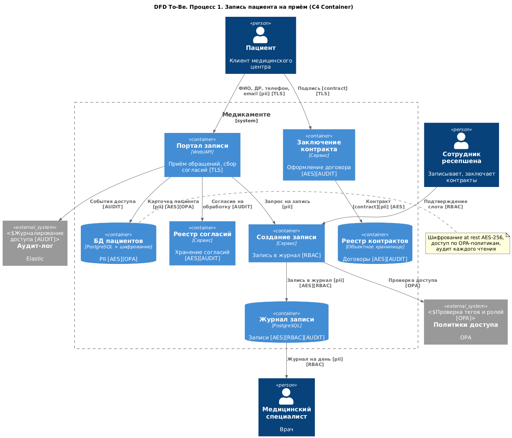
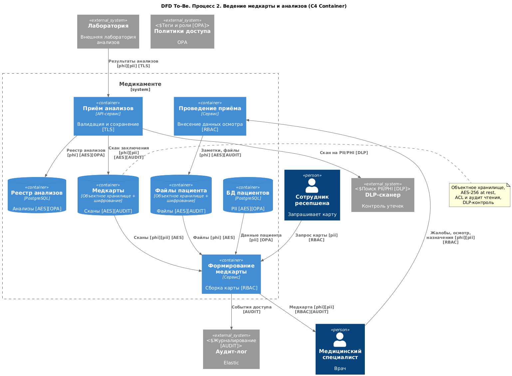
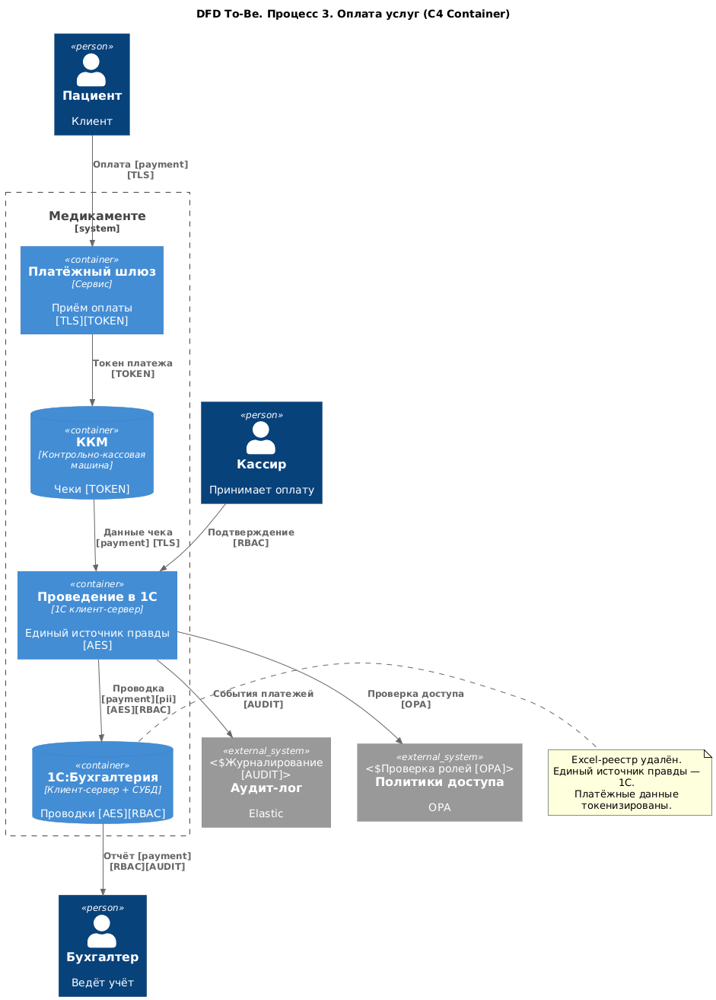
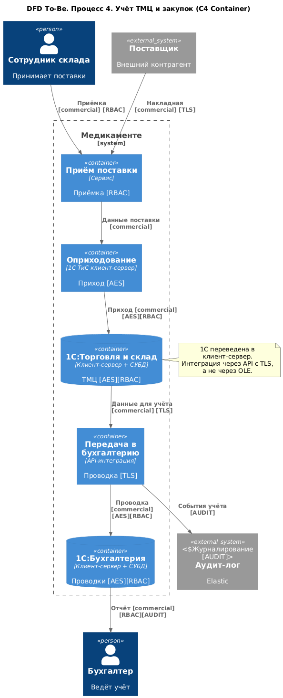
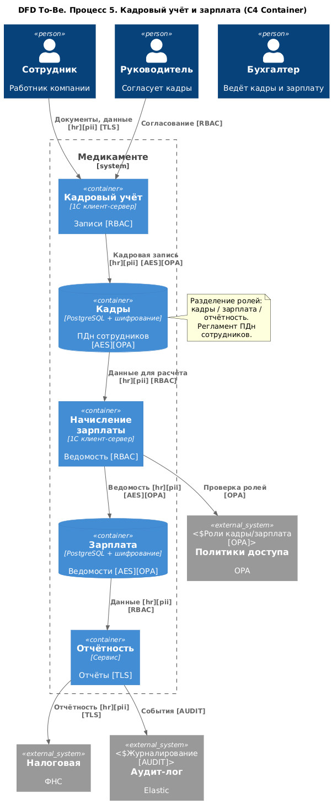

# DFD To-Be. Диаграммы потоков данных с мерами защиты

## 1. Назначение

Документ содержит доработанные диаграммы потоков данных (To-Be), на которых отражены меры защиты для каждого этапа потока. Опирается на `02_DFD_As-Is.md` и `07_Инструменты_и_меры.md`.

**Что изменилось по сравнению с As-Is:**
- Каждый поток с конфиденциальными данными помечен мерой: `[TLS]`, `[AES]`, `[TOKEN]`, `[MASK]`, `[AUDIT]`, `[RBAC]`, `[OPA]`.
- Файловые хранилища на общем диске заменены на защищённые: объектное хранилище, БД с шифрованием, реестр согласий.
- Неформальные каналы (почта, бумага) заменены на API с TLS.
- Добавлены процессы аудита и алертинга.

## 2. Перечень диаграмм

| № | Процесс | Уровень | Файл |
|---|---|---|---|
| 1 | Запись пациента (To-Be) | Container | `dfd_01_zapis_tobe.png` |
| 2 | Ведение медкарты (To-Be) | Container | `dfd_02_medkarta_tobe.png` |
| 3 | Оплата услуг (To-Be) | Container | `dfd_03_oplata_tobe.png` |
| 4 | Учёт ТМЦ (To-Be) | Container | `dfd_04_tmc_tobe.png` |
| 5 | Кадровый учёт (To-Be) | Container | `dfd_05_kadry_tobe.png` |
| 6 | Интеграция с лабораторией (To-Be) | Container | `dfd_06_lab_tobe.png` |

## 3. Легенда мер

| Метка | Мера |
|---|---|
| `[TLS]` | Шифрование канала TLS 1.3 |
| `[AES]` | Шифрование at rest AES-256 |
| `[TOKEN]` | Токенизация |
| `[MASK]` | Маскировка (динамическая или статическая) |
| `[AUDIT]` | Аудит доступа и изменений |
| `[RBAC]` | Разграничение доступа по ролям |
| `[OPA]` | Политика на основе тегов |
| `[DLP]` | Контроль утечек |

## 4. Диаграммы

### 4.1. Запись пациента (To-Be)

**Меры по потокам:**
- Пациент → портал: `[TLS]`, согласие на обработку `[AUDIT]`.
- Портал → БД пациентов: `[AES]`, `[OPA]`, `[AUDIT]`.
- Портал → журнал: `[RBAC]`, `[AUDIT]`.
- Контракт → реестр: `[AES]`, `[AUDIT]`, неизменяемое хранение.

**Изменения:** Excel заменён на БД портала, согласия собираются и хранятся, доступ по OPA-политикам.

---

### 4.2. Ведение медкарты (To-Be)

**Меры по потокам:**
- Врач → медкарта: `[RBAC]` (только врач), `[AUDIT]`.
- Лаборатория → API: `[TLS]`, контракт с тегами `[OPA]`.
- Медкарта → объектное хранилище: `[AES]`, `[AUDIT]`.
- Запрос карты ресепшеном: `[MASK]` (без PHI), `[AUDIT]`.

**Изменения:** общий диск заменён на объектное хранилище, аудит всех обращений.

---

### 4.3. Оплата услуг (To-Be)

**Меры по потокам:**
- Пациент → платёжный шлюз: `[TLS]`, `[TOKEN]`.
- Шлюз → 1С: `[TLS]`, `[AES]`, `[AUDIT]`.
- Excel-реестр удалён, единый источник правды — 1С.

**Изменения:** токенизация, убран двойной учёт.

---

### 4.4. Учёт ТМЦ (To-Be)

**Меры по потокам:**
- Поставщик → склад: `[TLS]`, `[RBAC]`.
- 1С ТиС → 1С Бухгалтерия: `[TLS]`, `[AUDIT]`.

**Изменения:** 1С переведена в клиент-сервер, интеграция через API с TLS.

---

### 4.5. Кадровый учёт (To-Be)

**Меры по потокам:**
- Сотрудник → 1С: `[TLS]`, `[RBAC]` (кадры / зарплата / отчётность).
- 1С → налоговая: `[TLS]`, `[AUDIT]`.

**Изменения:** разделение ролей, регламент ПДн сотрудников.

---

### 4.6. Интеграция с лабораторией (To-Be)

**Меры по потокам:**
- Ресепшен → API лаборатории: `[TLS]`, `[OPA]`, `[AUDIT]`.
- Лаборатория → API → реестр: `[TLS]`, `[AES]`, теги в контракте.
- Неформальные каналы (email, телефон, бумага) исключены.

**Изменения:** API с контрактом, скрывающим PII; валидация тегов; аудит.

## 5. Выводы

- Все критические потоки защищены: TLS, шифрование at rest, теги, аудит.
- Неформальные каналы устранены.
- Файловые хранилища заменены на защищённые.
- Двойной учёт устранён, источник правды определён.
- To-Be согласован с бизнес-целями: масштабирование, портал, мобильное приложение, BI/ML.