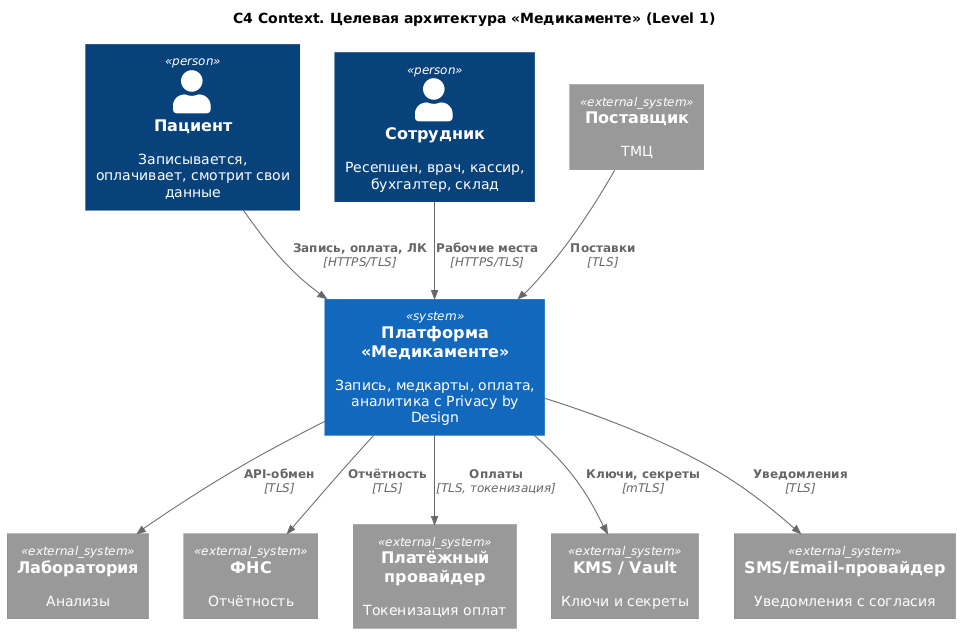
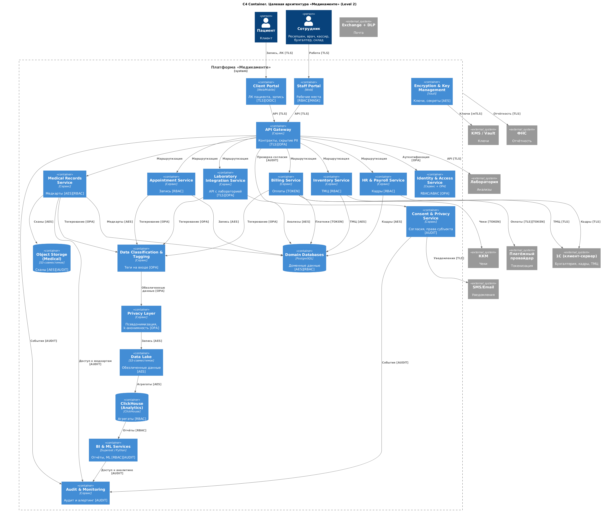

# Целевая архитектура «Медикаменте» (C4)

## 1. Назначение

Документ описывает целевую архитектуру (To-Be) в нотации C4: контекст (Level 1) и контейнеры (Level 2). 
Опирается на `01_Privacy_by_Design_анализ.md` и закрывает проблемные зоны Task1.

## 2. Контекст (C4 Level 1)

**Система «Медикаменте»** — единая платформа для записи, ведения медкарт, оплаты и аналитики.

**Внешние акторы:**
- Пациент — записывается, оплачивает, смотрит свои данные в ЛК.
- Сотрудник (ресепшен, врач, кассир, бухгалтер, склад) — работает через порталы.
- Лаборатория — обменивается данными через API.
- Налоговая (ФНС) — получает отчётность.
- Поставщик — поставляет ТМЦ.

**Внешние системы:**
- KMS / Vault — управление ключами и секретами.
- SMS/Email-провайдер — уведомления (с согласия).
- Платёжный провайдер — токенизация оплат.

## 3. Контейнеры (C4 Level 2)

### 3.1. Клиентские приложения

| Контейнер | Назначение | PbD-меры |
|---|---|---|
| Client Portal (Web/Mobile) | ЛК пациента, запись, просмотр своих данных | TLS, OIDC, доступ только к `subject_id` |
| Staff Portal (Web) | Рабочие места ресепшена, врача, кассира | RBAC/ABAC, маскировка PII в интерфейсе |

### 3.2. Периметр и доступ

| Контейнер | Назначение | PbD-меры |
|---|---|---|
| API Gateway | Единая точка входа для всех клиентов и систем | TLS 1.3, валидация контрактов, скрытие PII, защита от IDOR |
| Identity & Access Service | OIDC, RBAC/ABAC, интеграция с OPA | Default deny, контекстные политики |
| Consent & Privacy Service | Согласия, права субъекта, каскадное удаление | Предусловие обработки, аудит, неизменяемое хранение |

### 3.3. Доменные сервисы

| Контейнер | Назначение | PbD-меры |
|---|---|---|
| Appointment Service | Запись, расписание, уведомления | Теги на полях, аудит |
| Medical Records Service | Медкарты, анализы, заключения | Шифрование, ACL, аудит чтения |
| Billing Service | Оплаты, чеки, интеграция с 1С и ККМ | Токенизация, TLS |
| Laboratory Integration Service | API с лабораторией | Контракт с тегами, OPA, аудит |
| Inventory Service | ТМЦ, закупки | RBAC, коммерческая тайна |
| HR & Payroll Service | Кадры, зарплата | Разделение ролей, шифрование |

### 3.4. Данные и защита

| Контейнер | Назначение | PbD-меры |
|---|---|---|
| Data Classification & Tagging Service | Тегирование полей и файлов | Теги на входе, блокировка записи без тега |
| Encryption & Key Management (Vault) | Ключи, секреты, ротация | AES-256, HSM-совместимость |
| Audit & Monitoring Service | Аудит, алертинг аномалий | Elastic, правила корреляции |
| Object Storage (Medical) | Медкарты, сканы | AES-256 at rest, ACL, аудит |
| Databases (PostgreSQL) | Доменные данные | Шифрование, RBAC на уровне записей |

### 3.5. Аналитический слой

| Контейнер | Назначение | PbD-меры |
|---|---|---|
| Data Lake (Privacy Layer) | Сбор данных для BI/ML | Псевдонимизация, k-анонимность, теги |
| ClickHouse (Analytics) | Хранилище для отчётов | Только обезличенные данные |
| BI & ML Services | Отчёты, LLM, обучение моделей | Доступ по ролям, аудит, запрет реидентификации |

### 3.6. Внешние интеграции

| Система | Назначение | PbD-меры |
|---|---|---|
| 1С (клиент-сервер) | Бухгалтерия, кадры, ТМЦ | API с TLS, RBAC |
| ККМ | Чеки | Токенизация |
| Exchange + DLP | Почта | DLP, шифрование, аудит |
| Лаборатория | Анализы | API Gateway, OPA, аудит |
| Налоговая | Отчётность | TLS, аудит |
| Платёжный провайдер | Оплаты | Токенизация, PCI DSS |

## 4. Как блоки закрывают зоны Task1

| Зона Task1 | Закрывающий блок |
|---|---|
| 3.1 Медкарты на общем диске | Object Storage + Vault + Audit |
| 3.2 Нет аудита | Audit & Monitoring Service |
| 3.3 Неформальный обмен с лабораторией | API Gateway + Laboratory Integration Service |
| 3.4 Нет согласий | Consent & Privacy Service |
| 4.1 Нет RBAC/ABAC | Identity & Access Service + OPA |
| 4.5 Нет Data Lineage | Data Classification Service + Data Lake |
| 5.3 Нет уничтожения ПДн | Consent & Privacy Service (каскадное удаление) |

## 5. Выводы

- Архитектура реализует PbD в каждом слое: периметр, домены, данные, аналитика.
- Новые блоки не «надстройка», а несущие элементы: без них портал и мобильное приложение небезопасны.
- Аналитический слой изолирован от продакшн-данных Privacy Layer — BI/ML не видит PII.